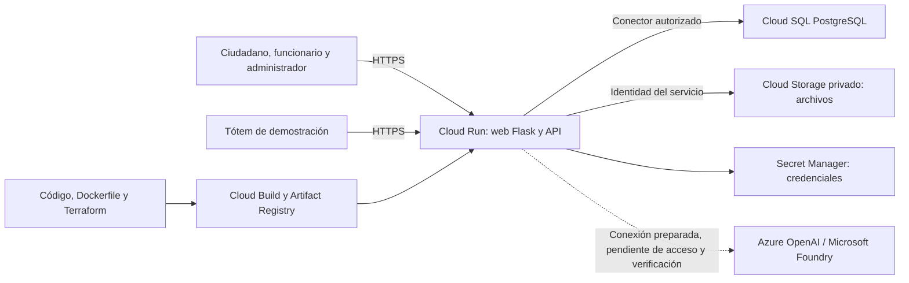

# Arquitectura de la PoC desplegada

La web y la API comparten un servicio Cloud Run. PostgreSQL conserva personas ficticias, solicitudes, estados, documentos/metadatos, citas, eventos y avisos. Los bytes de archivos se guardan en un bucket privado y se sirven por la API con comprobación de sesión y propiedad. No existe un enlace público directo al bucket.

Terraform crea la infraestructura GCP y sus permisos. Cloud Build construye la imagen; Artifact Registry la conserva. Cloud Run usa su identidad de servicio para acceder a SQL, Storage y Secret Manager. Las claves no viajan al navegador ni se incorporan al repositorio.

La flecha hacia Azure está discontinua porque el código y la conexión opcional existen, pero falta acceso a un recurso vigente y evidencia de inferencia real. Cuando se habilite, los archivos nuevos de prueba se enviarán al modelo visual; el resultado quedará como propuesta auditada; solo el funcionario cambia el estado documental. La asistencia de texto del funcionario es una función distinta. Ninguna resuelve el expediente completo automáticamente.

GEPOL y Registro Civil son registros simulados dentro de la misma aplicación; no representan conexiones reales a redes institucionales. Esta PoC no despliega la VPN, WAF, alta disponibilidad ni ambientes DEV/QA separados de una arquitectura productiva. La persistencia y el despliegue sí son servicios reales de GCP.
